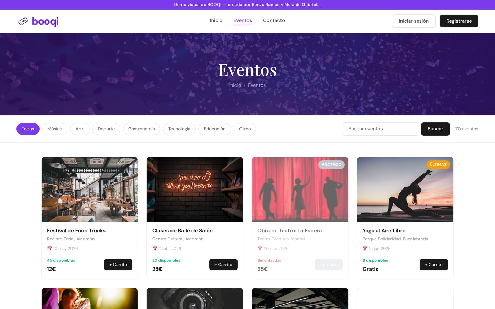
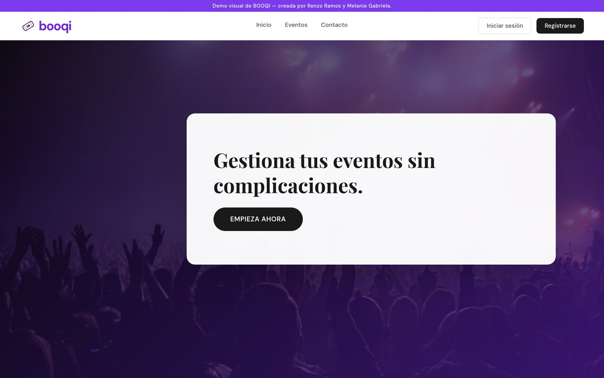
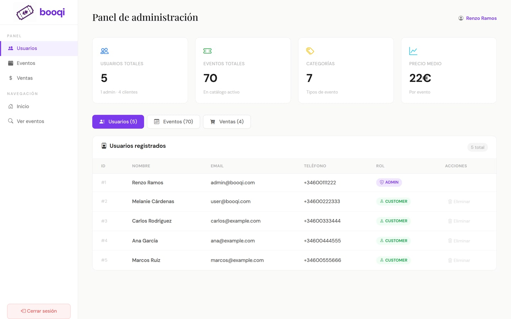
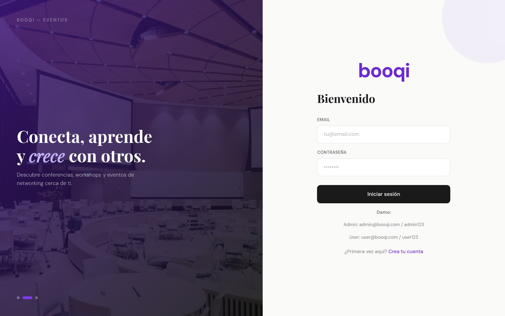

<div align="center">

# Booqi

**Sistema de gestión de reservas de eventos con arquitectura de microservicios.**

Explorar eventos, reservar entradas, pagar y generar el ticket en PDF.

[**Ver la presentación del proyecto →**](https://renzoramosdev.github.io/Booqui-TFG/) · [**Probar la demo →**](https://renzoramosdev.github.io/Booqui-TFG/demo/)


</div>

> [!NOTE]
> El primer enlace es la **landing del proyecto** (una página estática). El segundo es una **demo solo visual** de la app React: corre entera en el navegador con datos simulados (cuentas de cliente y de admin a un clic), sin microservicios detrás, así que nada de lo que se haga en ella llega a ningún servidor. El sistema completo se levanta con Docker Compose, como se explica en [Puesta en marcha](#puesta-en-marcha).
>
> Repositorio original: https://gitlab.com/booqui

---

## La aplicación

<div align="center">



</div>

| Portada | Panel de administración |
|:---:|:---:|
|  |  |
| Entrada al catálogo y a los eventos destacados. | Usuarios, eventos y ventas, con las métricas del catálogo. |

| Acceso | Contacto |
|:---:|:---:|
|  |  |
| Registro y login, con cuentas de demo a la vista. | Formulario de contacto. |

---

## Qué hace

| | |
|---|---|
| 👤 | **Gestión de usuarios** — registro, autenticación y administración de perfiles |
| 🎫 | **Catálogo de eventos** — exploración y búsqueda con información detallada |
| 🛒 | **Sistema de reservas** — proceso completo de reserva de entradas |
| 💳 | **Procesamiento de pagos** — gestión de transacciones |
| 📄 | **Generación de tickets** — creación automática en PDF |
| 📊 | **Panel de administración** — gestión de eventos, reportes y estadísticas |
| 🗂️ | **Mis reservas** — historial de reservas del usuario |

---

## Arquitectura

Cuatro microservicios Spring Boot (usuarios `8080`, eventos `8081`, reservas `8082`, pagos `8083`), cada uno con su propio
esquema en MySQL (*database per service*) y una API REST bajo `/api/v1/...` con errores RFC 9457 (ProblemDetail).
booking-service consulta a user-service y event-service; payment-service actualiza el stock en event-service y confirma o
cancela la reserva en booking-service. El frontend React se sirve con nginx, que además hace de proxy de la API.

Diagramas, flujo de checkout, plantilla de servicio y modelo de errores en [docs/architecture.md](docs/architecture.md);
las decisiones, en el [registro de ADR](docs/adr/README.md).

---

## Estructura

```
Booqui-TFG/
├── .github/workflows/          # ci.yml (build, test, lint) y pages.yml (landing + demo)
├── services/
│   ├── pom.xml                 # Agregador Maven de los cuatro servicios
│   ├── user-service/           # Usuarios y login
│   ├── event-service/          # Eventos y stock de entradas
│   ├── booking-service/        # Reservas
│   └── payment-service/        # Pagos simulados
├── frontend/                   # Aplicación React (Vite) servida por nginx
├── landing/                    # Landing estática (GitHub Pages)
├── infra/
│   ├── docker/
│   │   ├── docker-compose.yml
│   │   └── docker-compose.override.yml   # Puertos de los servicios y perfil dev
│   ├── db/init/
│   │   ├── 001_init_database.sql         # Esquemas y datos semilla
│   │   └── 002_create_app_user.sh        # Usuario de aplicación
│   └── .env.example
├── docs/
│   ├── architecture.md
│   ├── adr/                    # Decisiones de arquitectura
│   ├── assets/screenshots/
│   └── notes/
├── Makefile                    # Comandos de build, test, lint y despliegue
├── CONTRIBUTING.md
├── .editorconfig
└── .git-blame-ignore-revs
```

---

## Stack

### Backend

| Tecnología | Versión | Para qué |
|---|---|---|
| Java | 17 | Lenguaje principal |
| Spring Boot | 4.0.3 | Framework de las aplicaciones |
| Spring Web MVC, Data JPA, Validation, Actuator | gestionada por Spring Boot 4.0.3 | APIs REST, persistencia, validación y salud |
| Spring Security Crypto | gestionada por Spring Boot 4.0.3 | Hash BCrypt de contraseñas (user-service) |
| Lombok | gestionada por Spring Boot 4.0.3 | Menos código repetitivo |
| MapStruct | 1.6.3 | Mapeo entre entidades y DTO |
| springdoc-openapi | 3.0.3 | Documentación OpenAPI y Swagger UI |
| MySQL | 8.0 | Base de datos relacional |
| H2 | gestionada por Spring Boot 4.0.3 | Base de datos en memoria para las pruebas |
| Maven (wrapper) | 3.9.12 | Dependencias y build |

### Frontend

| Tecnología | Versión | Para qué |
|---|---|---|
| React | 19.3.1 | Interfaz de usuario |
| TypeScript | 6.0.3 | Tipado estricto (`strict: true`) |
| Vite | 8.3.5 | Build y servidor de desarrollo |
| Tailwind CSS | 4.3.3 | Estilos y sistema de diseño (tokens en CSS) |
| motion | 14.6.0 | Animaciones (respetando `prefers-reduced-motion`) |
| React Router | 7.18.4 | Enrutado |
| TanStack Query | 5.104.5 | Estado de servidor y caché |
| Axios | 1.20.0 | Cliente HTTP único |
| React Hook Form + Zod | 7.91.0 + 4.6.7 | Formularios y validación |
| Zustand | 5.0.16 | Sesión y tema |
| Lucide React | 1.61.0 | Iconografía |
| Vitest + Testing Library | 5.0.5 + 16.3.3 | Pruebas unitarias y de componentes |
| Playwright | 1.64.1 | Pruebas end-to-end |
| Stryker | 10.1.1 | Mutation testing de la lógica |

### Infraestructura y calidad

| Tecnología | Versión | Para qué |
|---|---|---|
| Docker Compose | v2 o superior | Orquestación de los seis contenedores |
| nginx | `nginx:alpine` | Sirve el frontend y hace de proxy de `/api/v1` |
| Imágenes de build | `eclipse-temurin` 17, `node:22-alpine` | Construcción de servicios y frontend |
| spotless + google-java-format | 3.10.4 + 1.35.0 (AOSP) | Formato del código Java |
| maven-checkstyle-plugin + Checkstyle | 3.6.0 + 12.3.1 | Reglas de estilo Java |
| pitest-maven + junit5 plugin | 1.17.0 + 1.2.2 | Mutation testing |
| ESLint / Prettier | 9.39.3 / 3.9.10 | Lint y formato de los frontends |
| GitHub Actions | Java 17 (temurin), Node 22 | Integración continua |

---

## Puesta en marcha

Requisitos: **Docker o Podman con Compose v2+** y **make** (GNU o POSIX). JDK 17 y Node 22 solo hacen falta para
construir o probar fuera de los contenedores.

```bash
cp infra/.env.example infra/.env   # cambia las contraseñas de ejemplo
make up
```

La primera vez se construyen las imágenes y el stack tarda unos 2–3 minutos en estar sano. Después, abre
<http://localhost>.

```bash
make ps      # estado de los contenedores
make logs    # logs en directo
make down    # parar el stack
make clean   # parar y borrar el volumen de MySQL (necesario tras cambiar el esquema)
```

> [!TIP]
> **Docker o Podman rootless.** Si el host no permite publicar el puerto 80 (`net.ipv4.ip_unprivileged_port_start` > 80),
> pon `BOOQI_FRONTEND_PORT=8088` en `infra/.env` y abre <http://localhost:8088>. Los montajes ya llevan `:z` para
> SELinux, y aunque Podman descarte el `HEALTHCHECK` de las imágenes, compose declara sus propios healthchecks.

## Servicios y URLs

| Componente | URL | Swagger UI | Salud |
|---|---|---|---|
| Frontend (+ proxy de la API) | <http://localhost> (o `:8088`) | — | — |
| user-service | <http://localhost:8080/api/v1/users> | <http://localhost:8080/swagger-ui.html> | <http://localhost:8080/actuator/health> |
| event-service | <http://localhost:8081/api/v1/events> | <http://localhost:8081/swagger-ui.html> | <http://localhost:8081/actuator/health> |
| booking-service | <http://localhost:8082/api/v1/bookings> | <http://localhost:8082/swagger-ui.html> | <http://localhost:8082/actuator/health> |
| payment-service | <http://localhost:8083/api/v1/payments> | <http://localhost:8083/swagger-ui.html> | <http://localhost:8083/actuator/health> |
| MySQL | `localhost:3307` | — | — |

Los puertos `8080`–`8083` los publica el override de desarrollo (`infra/docker/docker-compose.override.yml`), que
`make up` carga siempre. El OpenAPI en JSON está en `/v3/api-docs` de cada servicio.

## Credenciales de demo

| Rol | Email | Contraseña |
|---|---|---|
| ADMIN | `mel@booqi.com` | `admin_mel` |
| CUSTOMER | `andres.g@email.com` | `cust_pass_1` |

Son datos semilla de la base de datos local (`infra/db/init/001_init_database.sql`, guardados como hash BCrypt), no
credenciales reales.

## Comandos (Makefile)

| Comando | Qué hace |
|---|---|
| `make help` | Muestra la ayuda (objetivo por defecto) |
| `make up` | Construye y arranca el stack en segundo plano |
| `make down` | Para y elimina los contenedores del stack |
| `make clean` | Para el stack y borra sus volúmenes |
| `make logs` | Sigue los logs del stack |
| `make ps` | Lista los contenedores del stack |
| `make build` | Empaqueta cada servicio y construye cada frontend |
| `make test` | Ejecuta las pruebas de cada servicio |
| `make lint` | Comprueba formato y lint de servicios y frontends |
| `make format` | Aplica el formato con spotless y prettier |
| `make compose-config` | Valida los ficheros de compose (base + override de desarrollo) |

Los comandos de compose usan `infra/.env` si existe y, si no, `infra/.env.example`. Se puede forzar otro fichero con
`make up ENV_FILE=ruta/al/.env`.

---

## Calidad y CI

`.github/workflows/ci.yml` se ejecuta en cada push y pull request:

- **backend**: los cuatro servicios en paralelo con Java 17 y `./mvnw -B verify` (compilación, pruebas, spotless y
  checkstyle).
- **frontend**: `frontend` con Node 22: `npm ci`, lint, comprobación de formato, build, build de la demo de Pages y
  `npm test`.
- **compose**: validación de la configuración de compose.

`.github/workflows/pages.yml` publica en GitHub Pages, en cada push a `main` (o a mano), `landing/` tal cual en
<https://renzoramosdev.github.io/Booqui-TFG/> y la demo sin backend de la app (`npm run build:demo` en `frontend/`)
en <https://renzoramosdev.github.io/Booqui-TFG/demo/>. La landing se puede abrir en local con doble clic en
`landing/index.html`; para verla junto con la demo, ver [Demo en GitHub Pages](frontend/README.md#demo-en-github-pages).

## Limitaciones conocidas

Booqi es un proyecto académico y tiene limitaciones documentadas que no se han corregido, entre ellas:

- La autorización solo existe en el frontend: no hay token ni sesión en el servidor, y `PUT /api/v1/users/{id}` permite
  cambiar el rol.
- El pago no es idempotente y no hay compensación de stock si falla un paso posterior.
- No hay bloqueo al descontar stock, y la reserva no comprueba stock ni fecha del evento.
- El checkout solo mira el resultado del primer pago.
- Los datos semilla con tildes están mal codificados, así que los filtros con acentos no encuentran resultados.

Lista completa en [docs/architecture.md](docs/architecture.md#limitaciones-conocidas).

## Documentación

- [Arquitectura](docs/architecture.md)
- [Decisiones de arquitectura (ADR)](docs/adr/README.md)
- [Guía de contribución](CONTRIBUTING.md)
- Servicios: [user-service](services/user-service/README.md) ·
  [event-service](services/event-service/README.md) ·
  [booking-service](services/booking-service/README.md) ·
  [payment-service](services/payment-service/README.md)
- [Notas](docs/notes/)

---

## Autores

**Renzo Iván Ramos de los Ríos** ([@RenzoRamosDEV](https://github.com/RenzoRamosDEV)) ·
**Melanie Gabriela Cárdenas Hidalgo** ([@MelGabi](https://github.com/MelGabi))

## Licencia

[MIT](LICENSE)
