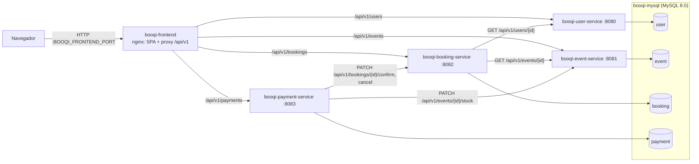
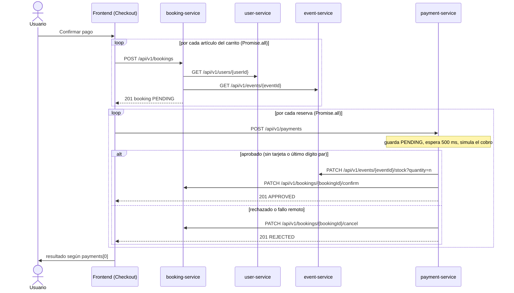

# Arquitectura de Booqi

Este documento describe cómo está construido Booqi: componentes, flujo principal, estructura interna de los servicios,
modelo de errores, configuración, despliegue y limitaciones conocidas. Las decisiones que explican esta forma están en
el [registro de ADR](adr/README.md).

## Visión general

Booqi es una plataforma de venta de entradas para eventos formada por cuatro microservicios Spring Boot (usuarios,
eventos, reservas y pagos), un frontend React servido por nginx y una base de datos MySQL. Cada servicio es dueño de su
propio esquema y se comunica con los demás solo por HTTP (`/api/v1/...`, ver
[ADR 0002](adr/0002-api-v1-y-problem-detail.md)). El navegador solo habla con el frontend, que hace de proxy de la API
(ver [ADR 0005](adr/0005-proxy-nginx-frontend.md)). Todo se levanta con Docker Compose desde `infra/docker/`.

## Diagrama de componentes



Una base de datos por servicio, implementada como cuatro esquemas (`user`, `event`, `booking`, `payment`) en un único
contenedor MySQL. Ningún servicio lee el esquema de otro: lo que necesita lo pide por HTTP. booking-service guarda una
copia (instantánea) de los datos del usuario y del evento en el momento de reservar.

## Flujo de checkout

El flujo más complejo es la compra desde el carrito (`frontend/src/pages/Checkout/Checkout.jsx`): primero se crean todas
las reservas en paralelo (`Promise.all`), después se procesan todos los pagos en paralelo y el resultado que ve el
usuario se decide solo con el primer pago (`payments[0]`).



Las llamadas entre servicios usan `RestClient` sobre el cliente HTTP del JDK, con 2 s de timeout de conexión, 5 s de
lectura y sin reintentos. Los fallos remotos se traducen así:

| Servicio | Resultado remoto | Respuesta |
|---|---|---|
| booking-service | 404 | 404 (reenvía el `detail` remoto si existe) |
| booking-service | 409, 422 u otro 4xx | 422 (reenvía el `detail` remoto si existe) |
| booking-service | 5xx, timeout, conexión rechazada | 503 |
| payment-service | cualquier fallo de stock o de confirmación | pago guardado como `REJECTED` con el motivo en `errorMessage`, reserva cancelada (mejor esfuerzo), respuesta 201 |

## Plantilla de servicio

Los cuatro servicios comparten la misma estructura (ver [ADR 0003](adr/0003-arquitectura-en-capas.md)). booking-service
es el ejemplo más completo:

```
services/<svc>-service/
├── Dockerfile  .dockerignore  mvnw  pom.xml  README.md
└── src/
    ├── main/java/com/booqi/<svc>/
    │   ├── <Svc>ServiceApplication.java
    │   ├── client/        (+ client/dto)   solo booking y payment
    │   ├── config/        CORS, JPA auditing, OpenAPI, RestClient
    │   ├── controller/
    │   ├── dto/request/   records + <Svc>Filter
    │   ├── dto/response/
    │   ├── entity/
    │   ├── exception/     excepciones + GlobalExceptionHandler
    │   ├── mapper/        MapStruct
    │   ├── repository/    Spring Data JPA
    │   └── service/       interfaz + impl/
    ├── main/resources/    application.yml, application-dev.yml, application-docker.yml
    └── test/              espejo de main + application-test.yml (H2)
```

| Paquete | Responsabilidad |
|---|---|
| `controller/` | Solo HTTP: rutas `/api/v1/<plural>`, `@Valid`, códigos de estado, cabecera `Location`, anotaciones OpenAPI. |
| `service/` + `service/impl/` | Reglas de negocio, transacciones, elección de la consulta según el filtro y lanzamiento de excepciones de dominio. |
| `repository/` | Interfaces Spring Data JPA con consultas derivadas. |
| `entity/` | Entidades JPA alineadas con `infra/db/init/001_init_database.sql` (Hibernate solo valida: `ddl-auto: validate`). |
| `dto/request/`, `dto/response/` | Records de entrada (con Bean Validation) y de salida; el filtro de listado es un record `<Svc>Filter`. |
| `mapper/` | Conversión entidad ↔ DTO con MapStruct. |
| `exception/` | `ResourceNotFoundException`, `ConflictException`, `BusinessException`, `InvalidFilterException` (y extras por servicio) y el `GlobalExceptionHandler`. |
| `client/` | Clientes HTTP hacia otros servicios y traducción de sus errores. |
| `config/` | CORS, `@EnableJpaAuditing`, OpenAPI y, donde aplica, `RestClient` o `PasswordEncoder`. |

Diferencias entre servicios (comprobadas con `find services/*/src/main/java -type d`):

- `client/` solo existe en booking-service y payment-service; `client/dto/` solo en booking-service.
- `config/RestClientConfig` solo en booking-service y payment-service; `config/PasswordConfig` (`BCryptPasswordEncoder`)
  solo en user-service.
- `InvalidCredentialsException` (401) solo en user-service; `RemoteServiceException` (503) solo en booking-service y
  payment-service.

## Modelo de errores

Todas las respuestas de error son RFC 9457 con `Content-Type: application/problem+json`. `type` es siempre
`about:blank`, `title` es el texto estándar del estado e `instance` es la ruta de la petición. Los cuatro
`GlobalExceptionHandler` son idénticos salvo el paquete y los extras indicados.

| Estado | Origen | `detail` | Servicios |
|---|---|---|---|
| 400 | Validación de `@Valid` | `Validation failed` + `errors: [{field, message}]` | todos |
| 400 | `InvalidFilterException` (filtros combinados) | mensaje de la excepción | todos |
| 401 | `InvalidCredentialsException` | `Invalid email or password` | user |
| 404 | `ResourceNotFoundException` | p. ej. `User with id 99 not found` | todos |
| 409 | `ConflictException` (duplicado) | mensaje de la excepción | todos |
| 422 | `BusinessException` (regla de negocio) | mensaje de la excepción | todos |
| 503 | `RemoteServiceException` | p. ej. `User service is unavailable` | booking, payment |
| 500 | Cualquier otra `Exception` | `An unexpected error occurred` (la traza solo va al log) | todos |

Los errores propios del framework (JSON mal formado, tipo de parámetro incorrecto, ruta inexistente, método no
permitido) también salen como ProblemDetail con `instance`.

Recurso inexistente (`GET /api/v1/users/99`):

```json
{"type":"about:blank","title":"Not Found","status":404,"detail":"User with id 99 not found","instance":"/api/v1/users/99"}
```

Validación (`POST /api/v1/users` con una contraseña corta):

```json
{"type":"about:blank","title":"Bad Request","status":400,"detail":"Validation failed","instance":"/api/v1/users",
 "errors":[{"field":"password","message":"La contraseña debe tener al menos 8 caracteres"}]}
```

Servicio remoto caído (`POST /api/v1/bookings` con user-service parado):

```json
{"type":"about:blank","title":"Service Unavailable","status":503,"detail":"User service is unavailable","instance":"/api/v1/bookings"}
```

El orden de los campos es ilustrativo.

## Configuración y perfiles

| Perfil | Fichero | Efecto |
|---|---|---|
| _(por defecto)_ | `application.yml` | MySQL en `localhost:3307`, URLs de otros servicios en `localhost:8080`–`8083`, actuator `health,info` con probes, Swagger UI en `/swagger-ui.html`. |
| `dev` | `application-dev.yml` | `spring.jpa.show-sql: true` y log `com.booqi: DEBUG`. Lo activa el override de desarrollo (`docker,dev`). |
| `docker` | `application-docker.yml` | Host `booqi-mysql` y nombres `booqi-*-service` como valores por defecto. Compose lo activa y además fija las variables explícitamente. |
| `test` | `src/test/resources/application-test.yml` | H2 en memoria en modo MySQL con `ddl-auto: create-drop`; solo en las pruebas (`@ActiveProfiles("test")`). |

| Variable | Dónde se define | Valor por defecto / ejemplo | Uso |
|---|---|---|---|
| `MYSQL_ROOT_PASSWORD` | `infra/.env.example` | `change-me-root` (obligatoria) | Contraseña de root de MySQL; solo la usan MySQL y sus scripts de inicio. |
| `BOOQI_DB_USER` | `infra/.env.example` | `booqi` (obligatoria) | Usuario de aplicación creado en el primer arranque, con privilegios solo sobre los cuatro esquemas. |
| `BOOQI_DB_PASSWORD` | `infra/.env.example` | `change-me-app` (obligatoria) | Contraseña de ese usuario; no puede contener comillas simples. |
| `BOOQI_CORS_ALLOWED_ORIGINS` | `infra/.env.example`, `application.yml` | `http://localhost,http://localhost:5173` (`.env.example`); `http://localhost:5173` (`application.yml`) | Orígenes admitidos para llamadas directas del navegador a los servicios. |
| `BOOQI_FRONTEND_PORT` | `infra/.env.example`, `docker-compose.yml` | `80` | Puerto del host que publica el frontend y la API proxificada. |
| `BOOQI_TAG` | `infra/.env.example`, `docker-compose.yml` | `latest` | Etiqueta de las imágenes `booqi/*`. |
| `SPRING_PROFILES_ACTIVE` | `docker-compose.yml`, override | `docker` (`docker,dev` con el override) | Perfiles activos de cada servicio. |
| `SPRING_DATASOURCE_URL` | `application.yml`, `docker-compose.yml` | `jdbc:mysql://localhost:3307/<db>`; en compose `jdbc:mysql://booqi-mysql:3306/<db>` | URL JDBC. |
| `SPRING_DATASOURCE_USERNAME` | `application.yml`, `docker-compose.yml` | `booqi`; en compose `${BOOQI_DB_USER}` | Usuario de base de datos. |
| `SPRING_DATASOURCE_PASSWORD` | `application.yml`, `docker-compose.yml` | vacío; en compose `${BOOQI_DB_PASSWORD}` | Contraseña de base de datos. |
| `BOOQI_USER_SERVICE_URL` | `application.yml` de booking, `docker-compose.yml` | `http://localhost:8080`; en compose `http://booqi-user-service:8080` | URL base de user-service. |
| `BOOQI_EVENT_SERVICE_URL` | `application.yml` de booking y payment, `docker-compose.yml` | `http://localhost:8081`; en compose `http://booqi-event-service:8081` | URL base de event-service. |
| `BOOQI_BOOKING_SERVICE_URL` | `application.yml` de payment, `docker-compose.yml` | `http://localhost:8082`; en compose `http://booqi-booking-service:8082` | URL base de booking-service. |
| `VITE_API_BASE_URL` | `frontend/.env.example` | vacío | Prefijo absoluto opcional de la API; vacío usa rutas relativas `/api/v1/...`. |

## Despliegue y operación

- **Topología.** `infra/docker/docker-compose.yml` (proyecto `booqi`) define `booqi-mysql`, los cuatro
  `booqi-*-service` y `booqi-frontend` en la red `booqi-network`, con el volumen `booqi-mysql-data`. MySQL se publica en
  el puerto `3307` del host y el frontend en `${BOOQI_FRONTEND_PORT:-80}`.
- **Inicialización de la base de datos.** Al crear el volumen se ejecutan `infra/db/init/001_init_database.sql`
  (esquemas, tablas y datos semilla) y `002_create_app_user.sh` (usuario de aplicación). No hay migraciones: tras cambiar
  el esquema hay que recrear el volumen con `make clean` y `make up`.
- **Healthchecks y orden de arranque.** Compose declara los healthchecks (`mysqladmin ping` por TCP en MySQL,
  `/actuator/health` en los servicios, `/` en el frontend) y encadena `depends_on: condition: service_healthy`:
  MySQL → user y event → booking → payment → frontend.
- **Override de desarrollo.** `infra/docker/docker-compose.override.yml` publica los puertos `8080`–`8083` y añade el
  perfil `dev`. El `Makefile` lo pasa siempre de forma explícita, por eso Swagger UI y actuator están disponibles en
  local.
- **Docker/Podman rootless.** Si `net.ipv4.ip_unprivileged_port_start` es mayor que 80 no se puede publicar el puerto 80:
  usa `BOOQI_FRONTEND_PORT=8088` en `infra/.env`. Con SELinux, los montajes ya llevan `:z`. El formato de imagen por
  defecto de Podman descarta la instrucción `HEALTHCHECK` del `Dockerfile`; no afecta, porque compose declara sus
  propios healthchecks.
- **Tiempo de arranque.** Medido en la fase de infraestructura: unos 195 s desde `make up` incluyendo la comprobación de
  build de las imágenes y 135 s sin ella.
- **Integración continua.** `.github/workflows/ci.yml` se ejecuta en cada push y pull request:
  - `backend`: matriz de los cuatro servicios con Java 17 (`temurin`) y `./mvnw -B verify` (compilación, pruebas,
    spotless y checkstyle).
  - `frontend`: matriz `frontend` y `frontend-demo` con Node 22: `npm ci`, `lint`, `format:check`, `build` y `npm test`
    (solo `frontend`). Se usa Node 22 porque Node 20 no expande el patrón `src/**/*.test.js` de `node --test`.
  - `compose`: `docker compose ... config -q` sobre el fichero base y el override.
  - `.github/workflows/pages.yml` publica `frontend-demo` en GitHub Pages desde `main` (todavía con Node 20).

## Limitaciones conocidas

Problemas detectados durante la refactorización y documentados, **no corregidos**:

1. **Escalada de rol** (user-service): `PUT /api/v1/users/{id}` acepta el campo `role`, así que cualquiera puede
   hacerse `ADMIN`.
2. **Sin autenticación en el servidor** (todos los servicios): no hay token ni sesión; la autorización solo existe en el
   frontend.
3. **Sesión sin caducidad** (frontend): el usuario autenticado se guarda en `localStorage` sin expiración.
4. **Longitud de contraseña inconsistente** (frontend `Register`): el formulario acepta 6 caracteres y la API exige 8.
5. **Mensaje de teléfono incorrecto** (`UpdateUserRequest` en user-service; `CreateEventRequest` y `UpdateEventRequest`
   en event-service): dice «entre 10 y 15 dígitos» pero la expresión regular acepta de 9 a 15.
6. **Pago no idempotente** (payment-service): repetir el pago de una reserva vuelve a descontar stock (doble descuento
   confirmado).
7. **Sin compensación de stock** (payment-service): si la confirmación de la reserva falla después de descontar stock,
   el stock no se devuelve.
8. **`totalPrice` sin validar** (payment-service): el importe que envía el cliente no se compara con la reserva.
9. **Reserva sin comprobar stock ni fecha** (booking-service): se puede reservar un evento agotado o pasado.
10. **Condición de carrera en `decrementStock`** (event-service): no hay bloqueo optimista ni pesimista.
11. **Transacción demasiado larga** (payment-service): `@Transactional` abarca las llamadas remotas y el `Thread.sleep`
    de la simulación.
12. **`contact_email` único en eventos** (`infra/db/init/001_init_database.sql`, event-service): un organizador solo
    puede tener un evento.
13. **Estado por defecto contradictorio** (booking-service): la entidad usa `CONFIRMED` por defecto y el servicio crea
    las reservas en `PENDING`.
14. **Confirmar una reserva cancelada** (booking-service): `PATCH /api/v1/bookings/{id}/confirm` no lo impide.
15. **Checkout solo mira el primer pago** (frontend `Checkout.jsx`): con varios artículos, el resultado mostrado sale
    de `payments[0]`.
16. **Pagos rechazados con 201** (payment-service): un pago `REJECTED` responde `201 Created`.
17. **503 inalcanzable en payment-service**: `RemoteServiceException` nunca llega al cliente como 503, porque todo fallo
    remoto se convierte en `REJECTED`.
18. **`detail` remoto largo** (payment-service): un `detail` de más de 500 caracteres hace fallar el guardado del pago
    `REJECTED` (`errorMessage` es `VARCHAR(500)`).
19. **Cuerpo 200 vacío de un remoto** (booking-service): provoca un `NullPointerException` y responde 500.
20. **Filtro `status` dependiente de la base de datos** (booking-service, payment-service): MySQL compara sin distinguir
    mayúsculas y H2 (pruebas) sí distingue.
21. **Datos semilla con doble codificación** (`infra/db/init/001_init_database.sql`): falta `SET NAMES utf8mb4`, así que
    los textos con tildes se guardan mal y los filtros con acentos no encuentran resultados.
22. **URL de servidor generada en OpenAPI** (todos los servicios): springdoc publica una URL de servidor calculada que
    puede no coincidir con el acceso real a través del proxy.
23. **Arranque lento** (stack completo): unos 195 s desde `make up` (135 s sin la comprobación de build).
